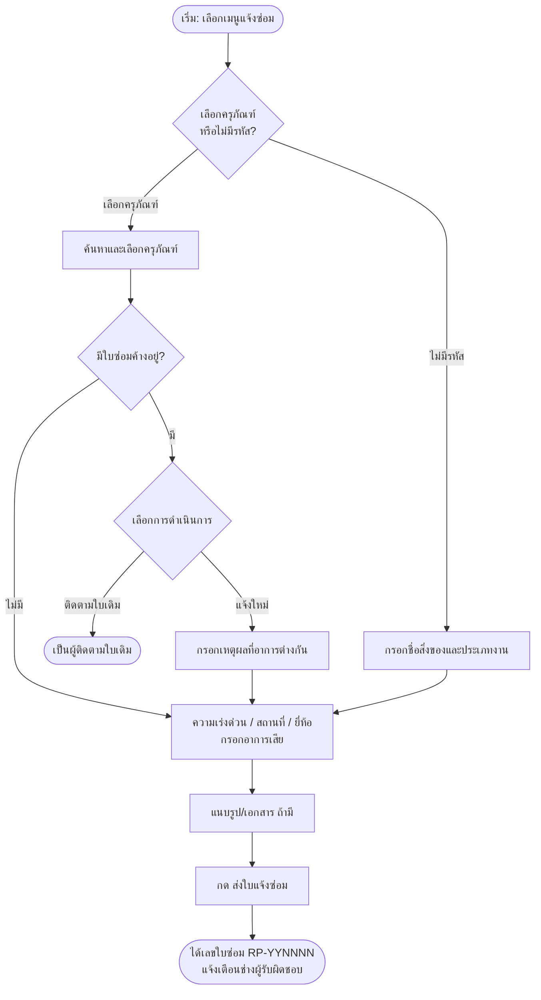
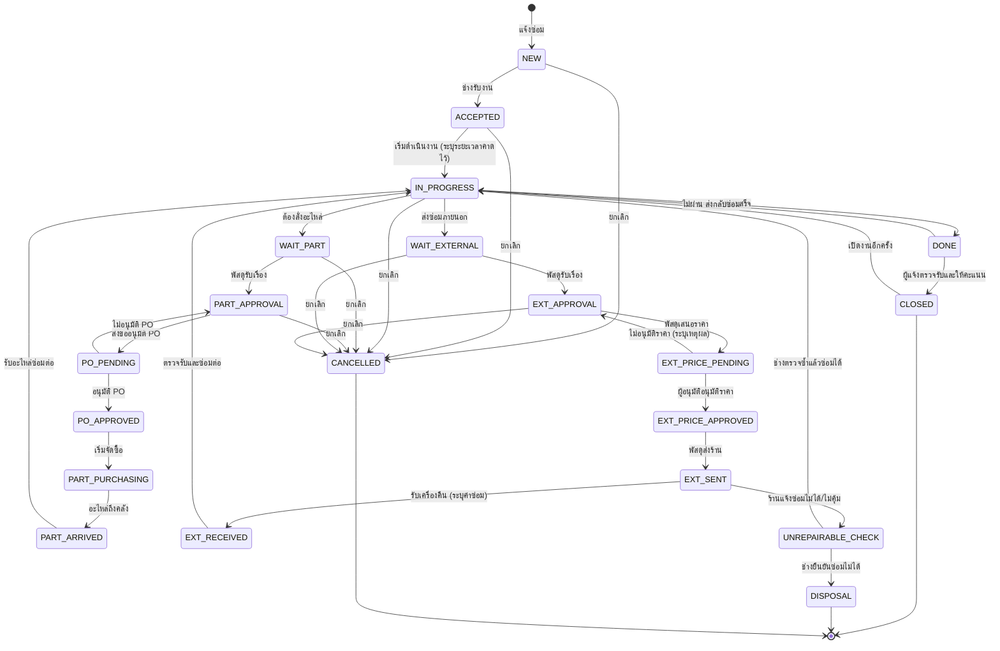
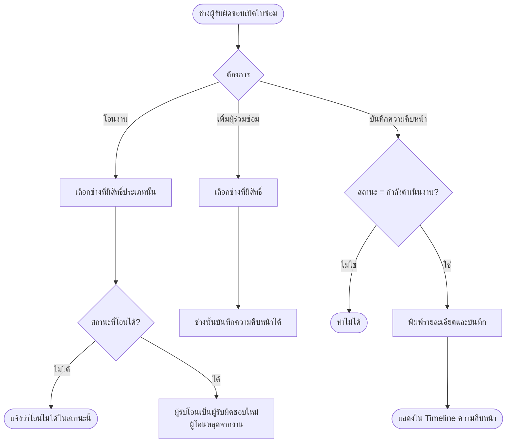
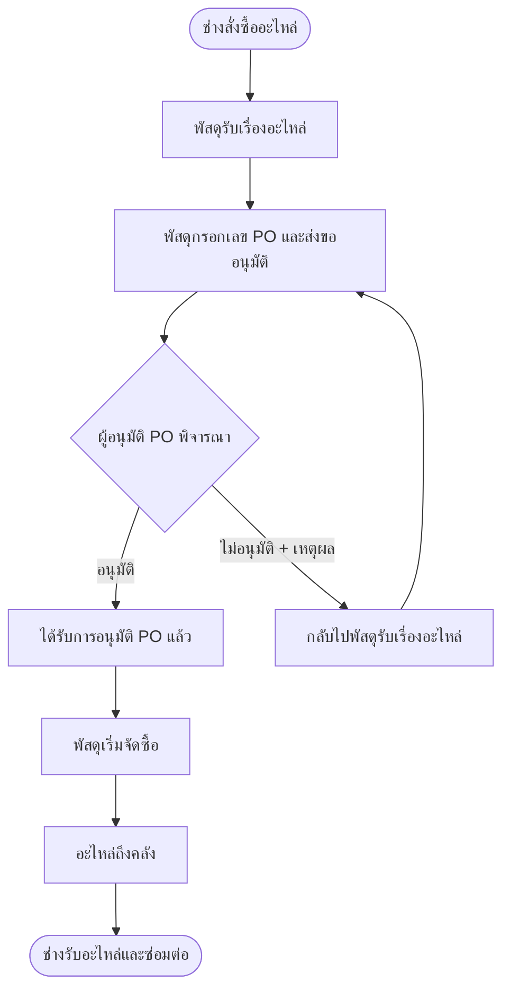
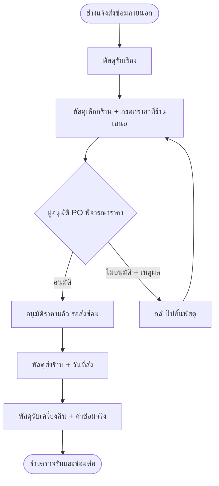

# คู่มือการใช้งานระบบแจ้งซ่อม (Repair System User Manual)

คู่มือนี้อธิบายการใช้งานเว็บระบบแจ้งซ่อม ทั้งแบบขั้นตอนและแบบแผนผัง (Flowchart)
อัปเดตล่าสุด: พฤศจิกายน 2569

---

## สารบัญ

1. [ภาพรวมระบบ](#1-ภาพรวมระบบ)
2. [บทบาทและสิทธิ์การใช้งาน](#2-บทบาทและสิทธิ์การใช้งาน)
3. [บัญชีทดสอบ](#3-บัญชีทดสอบ)
4. [การเข้าสู่ระบบและเมนูหลัก (Sidebar)](#4-การเข้าสู่ระบบและเมนูหลัก-sidebar)
5. [การแจ้งซ่อม](#5-การแจ้งซ่อม)
6. [หน้ารายการแจ้งซ่อม](#6-หน้ารายการแจ้งซ่อม)
7. [หน้ารายละเอียดใบซ่อม และการดำเนินการ](#7-หน้ารายละเอียดใบซ่อม-และการดำเนินการ)
8. [ขั้นตอนของแต่ละบทบาท](#8-ขั้นตอนของแต่ละบทบาท)
9. [การโอนงาน ผู้ร่วมซ่อม และความคืบหน้า](#9-การโอนงาน-ผู้ร่วมซ่อม-และความคืบหน้า)
10. [การอนุมัติ PO และการอนุมัติราคาซ่อมภายนอก](#10-การอนุมัติ-po-และการอนุมัติราคาซ่อมภายนอก)
11. [ประวัติการซ่อม ประวัติการทำงาน และประวัติการยื่น PO](#11-ประวัติการซ่อม-ประวัติการทำงาน-และประวัติการยื่น-po)
12. [ประวัติการตั้งค่า (Audit Log)](#12-ประวัติการตั้งค่า-audit-log)
13. [ตั้งค่าระบบ](#13-ตั้งค่าระบบ)
14. [การแจ้งเตือนและ SLA](#14-การแจ้งเตือนและ-sla)
15. [คำถามที่พบบ่อย](#15-คำถามที่พบบ่อย)

---

## 1. ภาพรวมระบบ

ระบบแจ้งซ่อมใช้สำหรับแจ้งซ่อมและติดตามงานซ่อมของครุภัณฑ์ใน 3 ประเภท:

| ประเภท | ตัวอย่าง |
|---|---|
| คอมพิวเตอร์ (COMPUTER) | เครื่องคอมพิวเตอร์, จอภาพ, เครื่องพิมพ์ |
| เครื่องมือแพทย์ (MEDICAL) | Infusion pump, เครื่องวัดความดัน |
| ทั่วไป (GENERAL) | เครื่องปรับอากาศ, ระบบไฟฟ้า, เฟอร์นิเจอร์ |

ใบซ่อมแต่ละใบจะมีเลขที่ในรูปแบบ `RP-YYNNNN` (เช่น `RP-690016`) และผ่านหลายสถานะตั้งแต่แจ้งซ่อมจนถึงปิดงาน

**ความสามารถหลัก**

- **ทุกตำแหน่งแจ้งซ่อมได้ทุกประเภท** (คอมพิวเตอร์ เครื่องมือแพทย์ ทั่วไป)
- แจ้งซ่อมได้ทั้งครุภัณฑ์ที่มีรหัส และสิ่งของที่ไม่มีรหัสครุภัณฑ์
- ระบุ **ยี่ห้อ** และ **ระยะเวลาที่คาดไว้ในการซ่อม (วัน)** เพื่อใช้วัดผลงาน
- ซื้ออะไหล่ผ่านขั้นตอน PO และอนุมัติโดยผู้อนุมัติ PO
- ส่งซ่อมภายนอกกับร้านค้า โดย **ต้องได้รับอนุมัติราคาก่อนส่งร้าน**
- กรณีซ่อมไม่ได้/ไม่คุ้ม ให้ช่างตรวจซ้ำและส่ง **รอจำหน่าย** พร้อมปรับสถานะทะเบียนครุภัณฑ์
- ประวัติการซ่อม ประวัติการทำงานของช่าง/พัสดุ และประวัติการยื่น PO แยกเป็นหน้าเฉพาะ

---

## 2. บทบาทและสิทธิ์การใช้งาน

| บทบาท | ทำอะไรได้ |
|---|---|
| **ผู้แจ้งซ่อม (Requester)** | แจ้งซ่อมได้ทุกประเภท ติดตามและเห็นเฉพาะใบซ่อมของตนเอง ตรวจรับงานและให้คะแนน |
| **ช่างซ่อม (Technician)** | รับงาน เริ่มงาน (ระบุระยะเวลาคาดไว้) ขอซื้ออะไหล่ ส่งซ่อมภายนอก ตรวจซ้ำ/ส่งรอจำหน่าย โอนงาน เพิ่มผู้ร่วมซ่อม บันทึกความคืบหน้า เปลี่ยนประเภทครุภัณฑ์ (มี/ไม่มีรหัส) |
| **พัสดุ (Supply)** | รับเรื่องอะไหล่/ส่งซ่อมภายนอก บันทึกราคาที่ร้านเสนอ ส่งขออนุมัติ PO และราคาซ่อม ส่งร้าน รับเครื่องคืน |
| **ผู้อนุมัติ PO (PO Approver)** | อนุมัติ/ไม่อนุมัติ PO และอนุมัติ/ไม่อนุมัติ **ราคาซ่อมภายนอก** (ต้องระบุเหตุผลเมื่อไม่อนุมัติ) |
| **ผู้ดูแลระบบ (Admin)** | เห็นทุกใบซ่อม ทุกสถานะ ทุกประเภท ตั้งค่าระบบ และดูประวัติการตั้งค่า |

> หมายเหตุ
> - **ทุกบทบาทแจ้งซ่อมได้ทั้ง 3 ประเภท** (คอมพิวเตอร์ เครื่องมือแพทย์ ทั่วไป)
> - ผู้ใช้จะเห็นเฉพาะใบซ่อมของประเภทที่ตนมีสิทธิ์ (เช่น ช่างคอมพิวเตอร์จะไม่เห็นใบซ่อมเครื่องมือแพทย์) ยกเว้นพัสดุ ผู้อนุมัติ PO และผู้ดูแลระบบ แต่จะเห็นใบซ่อมที่ตนเองแจ้งได้เสมอ
> - **ผู้แจ้งซ่อมเห็นเฉพาะใบที่ตนเองแจ้ง** ทั้งในหน้ารายการและประวัติการซ่อม

---

## 3. บัญชีทดสอบ

| Username | Password | บทบาท |
|---|---|---|
| `admin` | `admin123` | ผู้ดูแลระบบ (ทุกสิทธิ์) |
| `staff` | `staff123` | ผู้แจ้งซ่อม |
| `staff2` | `staff123` | ผู้แจ้งซ่อม (บัญชีที่ 2 สำหรับทดสอบหลายผู้แจ้ง) |
| `tech` | `tech123` | ช่างซ่อมทุกประเภท (คอมพิวเตอร์ + ทั่วไป + เครื่องมือแพทย์) |
| `tech2` | `tech123` | ช่างซ่อมทุกประเภท (คอมพิวเตอร์ + ทั่วไป + เครื่องมือแพทย์) |
| `supply` | `supply123` | พัสดุ |
| `poapprover` | `po123` | ผู้อนุมัติ PO |

---

## 4. การเข้าสู่ระบบและเมนูหลัก (Sidebar)

### 4.1 การเข้าสู่ระบบ

1. เปิดหน้าเว็บระบบแจ้งซ่อม
2. กรอก **Username** และ **Password** แล้วกดเข้าสู่ระบบ
3. หรือเข้าจากหน้า Hub (ระบบจะเข้าสู่ระบบให้อัตโนมัติ)

### 4.2 เมนู Sidebar

เมนูด้านซ้ายแสดงตามสิทธิ์ของผู้ใช้:

| ลำดับ | เมนู | คำอธิบาย |
|---|---|---|
| 1 | **Back to Hub** | กลับไปหน้า Hub |
| 2 | **รายการแจ้งซ่อม** | กลับไปหน้ารายการใบซ่อมทั้งหมด (อยู่บนสุด) |
| 3 | **กลุ่ม "แจ้งซ่อม"** | แจ้งซ่อมทั่วไป / คอมพิวเตอร์ / เครื่องมือแพทย์ (เห็นครบทั้ง 3 ประเภททุกบทบาท) |
| 4 | **กลุ่ม "รายการการแจ้งซ่อม"** | ดูรายการใบซ่อมแยกตามประเภท (เฉพาะประเภทที่เห็นได้) |
| 5 | **ประวัติการซ่อม** | ประวัติและสถิติการซ่อมของครุภัณฑ์ |
| 6 | **ประวัติการทำงาน** | ใบซ่อมที่คุณรับผิดชอบ/ร่วมซ่อม/ดำเนินการ (ช่างและพัสดุ) |
| 7 | **ประวัติการยื่น PO** | รายการ PO ที่คุณยื่น (พัสดุ และผู้ดูแลระบบ) |
| 8 | **ประวัติการตั้งค่า** | ประวัติการแก้ไขค่าตั้งและกฎ SLA (เฉพาะผู้มีสิทธิ์) |
| 9 | **ตั้งค่าระบบ** | ตั้งค่าระบบ (**เฉพาะผู้ดูแลระบบ**) |

ไอคอนด้านหน้าเมนูประเภทจะเหมือนกันทั้งกลุ่มแจ้งซ่อมและรายการแจ้งซ่อม:
- 🏢 ทั่วไป
- 🖥️ คอมพิวเตอร์
- 🩺 เครื่องมือแพทย์

มุมขวาบนของหน้าจอมีปุ่ม **🔔 การแจ้งเตือน** แสดงจำนวนรายการที่ยังไม่ได้อ่าน

---

## 5. การแจ้งซ่อม

### 5.1 ขั้นตอน

1. เลือกเมนู **แจ้งซ่อม → แจ้งซ่อม[ประเภท]** (เช่น "แจ้งซ่อมคอมพิวเตอร์")
2. เลือกครุภัณฑ์
   - ค้นหาด้วยรหัสหรือชื่อ แล้วเลือกจากรายการ
   - หรือติ๊ก **"ไม่มีรหัสครุภัณฑ์"** แล้วกรอกชื่อสิ่งของเอง และเลือกประเภทงาน
3. ระบบจะตรวจว่าเครื่องนี้มีใบซ่อมค้างอยู่หรือไม่
   - ถ้ามี ให้เลือก **"ติดตามใบเดิม"** หรือ **"แจ้งใหม่ (อาการต่างกัน)"** แล้วกรอกเหตุผล
4. เลือกความเร่งด่วน (ต่ำ / ปกติ / สูง / วิกฤต)
5. กรอกสถานที่ตั้ง (ระบบเติมให้จากครุภัณฑ์ได้)
6. กรอก **ยี่ห้อ (บังคับ)** — ใช้แสดงในข้อมูลครุภัณฑ์ของใบซ่อม
7. กรอก **อาการเสีย (บังคับ)**
8. แนบรูปอาการเสียหรือเอกสาร (ถ้ามี)
9. กด **ส่งใบแจ้งซ่อม**

ระบบจะสร้างใบซ่อมเลขที่ `RP-YYNNNN` และแจ้งเตือนช่างที่รับผิดชอบประเภทนั้นทันที

> **ยี่ห้อ** ต้องกรอกทุกครั้ง ทั้งกรณีเลือกครุภัณฑ์ที่มีรหัส และกรณีไม่มีรหัสครุภัณฑ์

### 5.2 Flowchart: การแจ้งซ่อม

---

## 6. หน้ารายการแจ้งซ่อม

หน้ารายการแสดงใบซ่อมพร้อมแท็บ ตัวกรอง และ SLA

### 6.1 แท็บตามบทบาท

| บทบาท | แท็บที่เห็น (เรียงตามที่แสดง) |
|---|---|
| ผู้แจ้งซ่อม | แจ้งซ่อมของฉัน, รอช่างรับงาน, รอตรวจรับ, รายการที่เสร็จสิ้น, ยกเลิก/ปฏิเสธ, ทั้งหมด |
| ช่าง | **รอช่างรับงาน (แท็บแรก)**, งานที่ฉันรับผิดชอบ, แจ้งซ่อมของฉัน, รอตรวจรับ, งานที่ยังไม่ปิด, รายการที่เสร็จสิ้น, ยกเลิก/ปฏิเสธ, ทั้งหมด |
| พัสดุ | งานพัสดุ, งานที่ฉันดำเนินการ, แจ้งซ่อมของฉัน, รอช่างรับงาน, รอตรวจรับ, งานที่ยังไม่ปิด, รายการที่เสร็จสิ้น, ยกเลิก/ปฏิเสธ, ทั้งหมด |
| ผู้อนุมัติ PO | **รออนุมัติ PO / ราคาซ่อม** (แสดงเฉพาะใบที่รออนุมัติ PO และรออนุมัติราคาซ่อมภายนอก), แจ้งซ่อมของฉัน |
| ผู้ดูแลระบบ | งานที่ยังไม่ปิด, รอรับงาน, รอตรวจรับ, งานพัสดุ, รายการที่เสร็จสิ้น, ยกเลิก/ปฏิเสธ, ทั้งหมด |

> ช่างจะเห็นแท็บ **"รอช่างรับงาน" เป็นแท็บแรก** เพื่อให้เริ่มงานใหม่ได้ทันที
> ทุกบทบาทเห็นแท็บ **"แจ้งซ่อมของฉัน"** เพราะทุกตำแหน่งแจ้งซ่อมได้ทุกประเภท

### 6.2 คอลัมน์ในตาราง

| คอลัมน์ | รายละเอียด |
|---|---|
| เลขใบซ่อม | เลขที่ใบซ่อม |
| ครุภัณฑ์ / อาการ | ชื่อเรื่อง รหัสครุภัณฑ์ แผนก และความเร่งด่วน |
| ประเภท | คอมพิวเตอร์ / เครื่องมือแพทย์ / ทั่วไป |
| สถานะ | สถานะปัจจุบัน (มีป้าย "ประกัน" ถ้าอยู่ในประกัน) |
| SLA | เวลาที่ค้างอยู่ในสถานะเทียบกับเวลาที่กำหนด |
| ช่าง | ช่างผู้รับผิดชอบ |
| **ระยะเวลา (วัน)** | จำนวนวันนับจากวันที่รับงาน (หรือวันที่แจ้ง ถ้ายังไม่รับงาน) ถึงวันที่ปิดงาน (หรือปัจจุบัน) |
| แจ้งเมื่อ | วันที่และเวลาที่แจ้ง |

### 6.3 ตัวกรองและการค้นหา

- **ประเภทงาน**: เมื่อเข้าจากเมนูประเภทใด ตัวเลือกประเภทจะล็อก ให้เปลี่ยนประเภทจากเมนู Sidebar
- **ช่องค้นหา**: ค้นจากเลขใบซ่อม ชื่อ หรือรหัสครุภัณฑ์
- **ปุ่มสลับมุมมอง**:
  - *จัดลำดับ: ของฉันก่อน* (ค่าเริ่มต้น) แสดงใบที่ตนเป็นผู้แจ้งก่อน
  - *แสดงทั้งหมด (ไม่จัดลำดับของฉันก่อน)*

### 6.4 การเรียงลำดับ

กดที่หัวตาราง **เลขใบซ่อม / สถานะ / SLA / แจ้งเมื่อ** เพื่อเรียง:
- กดครั้งแรก เรียงจากมากไปน้อย (▼)
- กดอีกครั้ง เรียงจากน้อยไปมาก (▲)

### 6.5 ตัวบ่งชี้ SLA

| สี | ความหมาย |
|---|---|
| เขียว | ปกติ (ยังไม่ถึงกำหนด) |
| เหลือง | ใกล้ครบกำหนด (ถึง 80% ของเวลาที่กำหนด) |
| แดง | ครบกำหนดหรือเกินกำหนดแล้ว |

กดที่แถวใดก็ได้เพื่อเปิดหน้ารายละเอียดใบซ่อม

---

## 7. หน้ารายละเอียดใบซ่อม และการดำเนินการ

### 7.1 ส่วนประกอบของหน้า

| ส่วน | รายละเอียด |
|---|---|
| หัวใบซ่อม | เลขใบซ่อม ชื่อเรื่อง สถานะ ประเภท และความเร่งด่วน |
| ปุ่มการดำเนินการ (มุมขวาบน) | ปุ่มติดตาม/เลิกติดตาม, **เปลี่ยนประเภทครุภัณฑ์** (ช่างผู้รับผิดชอบ), โอนงาน, และปุ่มสถานะถัดไปตามสิทธิ์ของคุณ |
| Timeline | ประวัติการเปลี่ยนสถานะและการแจ้งเตือน SLA เรียงจากล่าสุด |
| ความคืบหน้าการซ่อม | บันทึกความคืบหน้า (เฉพาะสถานะกำลังดำเนินงาน) |
| ผู้ร่วมซ่อม | รายชื่อผู้ร่วมซ่อม (ช่างผู้รับผิดชอบเพิ่ม/นำออกได้) |
| รายการอะไหล่ | อะไหล่ที่ขอซื้อ (พัสดุบันทึกราคาจริงได้) |
| ใบสั่งซื้อ (PO) | เลข PO สถานะ และผู้อนุมัติ |
| ส่งซ่อมภายนอก | ข้อมูลร้าน ราคาที่ร้านเสนอ ผลอนุมัติราคา และค่าซ่อมจริง |
| ไฟล์แนบ | รูปและเอกสารของใบซ่อม |
| ข้อมูลครุภัณฑ์ | ข้อมูล ณ วันที่แจ้ง รวม **ยี่ห้อ**, **ระยะเวลาที่คาดไว้**, ผู้ซ่อมเสร็จ และผู้ปิดงาน |
| ผู้ติดตาม | ผู้ที่ติดตามใบนี้ |
| ซ่อมครั้งก่อนของเครื่องนี้ | ใบซ่อมก่อนหน้าของครุภัณฑ์เดียวกัน |

ในส่วน **ส่งซ่อมภายนอก** จะแสดงชื่อผู้รับผิดชอบและบริษัท/ร้านในบรรทัดเดียวกัน รูปแบบ
`ส่งเรื่องโดย <ชื่อผู้รับผิดชอบ> · <ชื่อร้าน/บริษัท>` เพื่อให้รู้ว่าข้อมูลร้านนี้มาจากใคร

### 7.2 สถานะของใบซ่อม

| รหัสสถานะ | ชื่อที่แสดง |
|---|---|
| NEW | แจ้งซ่อม |
| ACCEPTED | รับงานซ่อม |
| IN_PROGRESS | กำลังดำเนินงาน |
| WAIT_PART | สั่งซื้ออะไหล่ |
| PART_APPROVAL | พัสดุรับเรื่องอะไหล่ |
| PO_PENDING | รออนุมัติ PO |
| PO_APPROVED | ได้รับการอนุมัติ PO แล้ว |
| PART_PURCHASING | กำลังจัดซื้ออะไหล่ |
| PART_ARRIVED | อะไหล่ถึงคลัง |
| WAIT_EXTERNAL | แจ้งส่งซ่อมภายนอก |
| EXT_APPROVAL | รออนุมัติส่งซ่อม |
| **EXT_PRICE_PENDING** | **รออนุมัติราคาซ่อมภายนอก** |
| **EXT_PRICE_APPROVED** | **อนุมัติราคาแล้ว รอส่งซ่อม** |
| EXT_SENT | ส่งร้านภายนอกแล้ว |
| EXT_RECEIVED | รับอุปกรณ์คืนแล้ว |
| **UNREPAIRABLE_CHECK** | **ช่างตรวจซ้ำ (ซ่อมไม่ได้/ไม่คุ้ม)** |
| **DISPOSAL** | **รอจำหน่าย** |
| DONE | รอตรวจรับ |
| CLOSED | ปิดงาน |
| CANCELLED | ยกเลิก |

> สถานะ **รอจำหน่าย (DISPOSAL)** เป็นสถานะสุดท้าย ปิดใบซ่อมและปรับสถานะทะเบียนครุภัณฑ์เป็น "รอจำหน่าย" ไม่สามารถเปิดงานต่อได้

### 7.3 Flowchart: วงจรสถานะของใบซ่อม (ภาพรวม)

---

## 8. ขั้นตอนของแต่ละบทบาท

### 8.1 ช่างซ่อม (Technician)

#### ขั้นที่ 1: รับงาน
1. เปิดใบซ่อมสถานะ **แจ้งซ่อม** จากแท็บ "รอช่างรับงาน" (แท็บแรกของช่าง)
2. กดปุ่ม **รับงานซ่อม** (ระบบจะตั้งชื่อคุณเป็นผู้รับผิดชอบ)
3. ถ้าครุภัณฑ์มีรหัส ทะเบียนครุภัณฑ์จะเปลี่ยนเป็น "อยู่ระหว่างซ่อม"

#### ขั้นที่ 2: เริ่มดำเนินงาน
1. กด **เริ่มดำเนินงาน**
2. กรอก **ระยะเวลาที่คาดไว้ในการซ่อม (จำนวนวัน) (บังคับ)** ตั้งแต่ 1 วันขึ้นไป
3. บันทึกความคืบหน้าได้ตามต้องการ (ดูหัวข้อที่ 9)

> ระยะเวลาที่คาดไว้จะแสดงในข้อมูลครุภัณฑ์ของใบซ่อม และใช้เปรียบเทียบกับจำนวนวันทำงานจริงในหน้ารายการ

#### ขั้นที่ 3: เปลี่ยนประเภทครุภัณฑ์ (มีรหัส / ไม่มีรหัส)
ใช้เมื่อพบว่ารหัสครุภัณฑ์ไม่ตรงกับเครื่องที่ซ่อมจริง

- ผู้ทำได้: **ช่างผู้รับผิดชอบ** ในสถานะ **รับงานซ่อม** หรือ **กำลังดำเนินงาน**
- กด **เปลี่ยนประเภทครุภัณฑ์**
- เลือกครุภัณฑ์ใหม่ที่มีประเภทเดียวกัน หรือเลือก **"ไม่มีรหัสครุภัณฑ์"**
- กรอก **เหตุผลที่เปลี่ยน (บังคับ)** แล้วกดยืนยัน
- ระบบจะคืนสถานะทะเบียนของเครื่องเดิมเป็น "ใช้งานได้" และตั้งเครื่องใหม่เป็น "อยู่ระหว่างซ่อม"

#### ขั้นที่ 4: ถ้าต้องใช้อะไหล่
1. กด **สั่งซื้ออะไหล่**
2. กรอกรายการอะไหล่: ชื่อ, รหัส, จำนวน, หน่วย, ราคาประมาณ
3. **แนบรูปอย่างน้อย 1 รูปต่อรายการอะไหล่ (บังคับ)**
4. กดยืนยัน ระบบจะแจ้งพัสดุ
5. เมื่ออะไหล่มาถึง พัสดุจะเปลี่ยนสถานะเป็น "อะไหล่ถึงคลัง" ให้กด **รับอะไหล่แล้ว ซ่อมต่อ**

#### ขั้นที่ 5: ถ้าต้องส่งซ่อมภายนอก
1. กด **ส่งเรื่องซ่อมภายนอก**
2. กรอกอาการ/เหตุผล (บังคับ) และ **ร้านที่เสนอ** (ถ้ามี)
   - ช่องร้านเป็นรายการ dropdown จากร้านที่เคยบันทึกไว้ **หรือพิมพ์ชื่อร้านใหม่ได้**
   - ติ๊ก "อยู่ในประกัน" ได้ถ้าเครื่องยังอยู่ในประกัน
3. พัสดุจะเป็นผู้บันทึกราคาที่ร้านเสนอและส่งขออนุมัติ
4. เมื่อได้รับอนุมัติราคาและพัสดุส่งร้านแล้ว รอพัสดุรับเครื่องคืน
5. กด **ตรวจรับอุปกรณ์และซ่อมต่อ** เมื่อได้รับเครื่องคืน

#### ขั้นที่ 6: ซ่อมเสร็จ
1. กด **ซ่อมเสร็จ**
2. เลือกผลการซ่อม: ซ่อมได้ / ซ่อมไม่ได้ (รอจำหน่าย) / ตรวจแล้วไม่พบอาการ
3. กรอกสิ่งที่ซ่อม/ผลการซ่อม (บังคับ) และแนบรูปผลการซ่อม (ไม่บังคับ)
4. กดยืนยัน ระบบจะบันทึกชื่อคุณเป็น **ผู้ซ่อมเสร็จ** และส่งเรื่องให้ผู้แจ้งตรวจรับ

#### กรณีซ่อมไม่ได้ / ไม่คุ้มซ่อม
1. เมื่อพัสดุรับเครื่องคืนจากร้านและแจ้งว่า **ซ่อมไม่ได้/ไม่คุ้ม** ใบจะอยู่สถานะ **ช่างตรวจซ้ำ (ซ่อมไม่ได้/ไม่คุ้ม)**
2. ช่างตรวจสอบอีกครั้ง แล้วเลือก:
   - **ช่างตรวจซ้ำแล้ว ซ่อมต่อได้** → กลับไป "กำลังดำเนินงาน"
   - **ช่างตรวจซ้ำแล้ว ส่งรอจำหน่าย** → กรอกเหตุผล (บังคับ)
3. เมื่อส่งรอจำหน่าย ระบบจะปิดใบซ่อม (ผลการซ่อม = ซ่อมไม่ได้) และปรับสถานะทะเบียนครุภัณฑ์เป็น **รอจำหน่าย**

#### ถ้าผู้แจ้งส่งกลับซ่อม
- ใบจะกลับเป็น "กำลังดำเนินงาน" พร้อมเหตุผล ให้ซ่อมใหม่และกดซ่อมเสร็จอีกครั้ง

### 8.2 ผู้แจ้งซ่อม (Requester/Staff)

1. เปิดใบซ่อมที่สถานะ **รอตรวจรับ (DONE)**
2. ตรวจสอบงานซ่อม แล้วเลือก:
   - **ตรวจรับและปิดงาน**: ให้คะแนนความพึงพอใจ 1–5 ดาว (บังคับ) และใส่ **ข้อเสนอแนะ** (ไม่บังคับ)
   - **ไม่ผ่าน ส่งกลับซ่อม**: กรอกเหตุผล (บังคับ) ใบจะกลับไปที่ช่าง
3. **ยกเลิกใบซ่อม**: ทำได้ในสถานะที่ระบบเปิดให้ (ก่อนเริ่มซ่อมหรือระหว่างดำเนินการ) ต้องกรอกเหตุผล (บังคับ)
4. ถ้างานปิดไปแล้วและยังไม่หาย สามารถ **เปิดงานอีกครั้ง** ได้ (ยกเว้นใบที่รอจำหน่าย)
5. ผู้แจ้งเห็นเฉพาะใบซ่อมของตนเองในหน้ารายการและประวัติการซ่อม

### 8.3 พัสดุ (Supply)

#### อะไหล่
1. รับเรื่องอะไหล่: เปลี่ยนเป็น **พัสดุรับเรื่องอะไหล่** (เมื่อช่างสั่งซื้อ)
2. **ส่งขออนุมัติ PO**: กรอกเลขที่ PO (บังคับ) และวันที่ PO (ค่าเริ่มต้นคือวันนี้) แนบเอกสาร PO ได้
3. รอผู้อนุมัติ PO
   - ถ้าอนุมัติ: เปลี่ยนเป็น "ได้รับการอนุมัติ PO แล้ว" ให้กด **เริ่มจัดซื้ออะไหล่**
   - ถ้าไม่อนุมัติ: ใบจะกลับมาที่ "พัสดุรับเรื่องอะไหล่" พร้อมเหตุผล ให้แก้ไขแล้วส่งขออนุมัติ PO ใหม่
4. เมื่ออะไหล่มาถึง กด **อะไหล่ถึงคลังแล้ว**
5. บันทึก **ราคาจริงของอะไหล่** ได้ในรายการอะไหล่ (การแก้ไขราคาที่บันทึกแล้วต้องระบุเหตุผล)

#### ส่งซ่อมภายนอก
1. กด **รับเรื่องส่งซ่อม** (สถานะ "รออนุมัติส่งซ่อม")
2. กด **ส่งขออนุมัติราคาซ่อมภายนอก**:
   - เลือก **ร้านที่ส่งซ่อม (บังคับ)** จากรายการร้านที่เคยบันทึก หรือพิมพ์ชื่อใหม่
   - กรอก **ราคาที่ร้านเสนอ (บาท) (บังคับ)**
3. รอผู้อนุมัติ PO อนุมัติราคา
   - ถ้าไม่อนุมัติ ใบจะกลับมาที่ "รออนุมัติส่งซ่อม" พร้อมเหตุผล ให้เทียบราคาใหม่และส่งขออนุมัติอีกครั้ง
4. เมื่ออนุมัติแล้ว กด **ส่งร้านภายนอกแล้ว**: กรอก **วันที่ส่ง (บังคับ)** (ไม่ต้องกรอกชื่อร้านซ้ำ ระบบใช้ชื่อร้านเดิม)
5. เมื่อได้เครื่องคืน กด **รับอุปกรณ์คืนแล้ว**: กรอก **วันที่รับอุปกรณ์คืน (บังคับ)** และ **ค่าซ่อมจริง (บังคับ)** รวมถึงเลขใบแจ้งหนี้/ใบเสร็จ (ถ้ามี)
6. ถ้าร้านแจ้งว่าซ่อมไม่ได้/ไม่คุ้ม ให้กด **รับคืน: ซ่อมไม่ได้/ไม่คุ้ม ส่งช่างตรวจซ้ำ** พร้อมกรอกเหตุผล (บังคับ)

> วันที่ทุกช่องจะตั้งค่าเริ่มต้นเป็นวันปัจจุบัน และไม่สามารถเลือกวันในอนาคตได้

### 8.4 ผู้อนุมัติ PO (PO Approver)

1. เปิดแท็บ **รออนุมัติ PO / ราคาซ่อม** ซึ่งจะแสดงเฉพาะใบที่รอการอนุมัติ PO และรออนุมัติราคาซ่อมภายนอก
2. ตรวจสอบรายการอะไหล่และเอกสาร PO
3. เลือกการดำเนินการ:
   - **อนุมัติ PO**: ใบจะไปต่อที่ "กำลังจัดซื้ออะไหล่"
   - **ไม่อนุมัติ PO**: กรอกเหตุผล (บังคับ) ใบจะกลับไปให้พัสดุตรวจสอบและส่งขออนุมัติใหม่

**การอนุมัติราคาซ่อมภายนอก**

เมื่อพัสดุส่งขออนุมัติราคา ใบจะอยู่สถานะ **รออนุมัติราคาซ่อมภายนอก** และผู้อนุมัติ PO จะเห็นปุ่ม:

- **อนุมัติราคาซ่อมภายนอก** → ใบไปสถานะ "อนุมัติราคาแล้ว รอส่งซ่อม"
- **ไม่อนุมัติราคา ส่งกลับให้พัสดุ** → กรอกเหตุผล (บังคับ) ใบกลับไปสถานะ "รออนุมัติส่งซ่อม"

> ผู้อนุมัติ PO ไม่ได้เป็นผู้ส่งร้านหรือรับเครื่องคืน ขั้นตอนเหล่านั้นเป็นของพัสดุ

---

## 9. การโอนงาน ผู้ร่วมซ่อม และความคืบหน้า

### 9.1 โอนงานให้ช่างคนอื่น
- ผู้ทำได้: **ช่างผู้รับผิดชอบปัจจุบัน** หรือผู้ดูแลระบบ
- ทำได้ในสถานะ: รับงานซ่อม, กำลังดำเนินงาน, สั่งซื้ออะไหล่, แจ้งส่งซ่อมภายนอก, อะไหล่ถึงคลัง, รับเครื่องคืนแล้ว, ช่างตรวจซ้ำ
- ขั้นตอน: กด **โอนงานให้ช่างคนอื่น** → เลือกช่างที่มีสิทธิ์ประเภทนั้น → ใส่เหตุผล (ไม่บังคับ) → ยืนยัน
- ผลลัพธ์: ชื่อผู้รับผิดชอบเปลี่ยนทันที และแจ้งเตือนผู้แจ้ง ผู้รับโอน และผู้ติดตาม

### 9.2 ผู้ร่วมซ่อม (Co-technician)
- เพิ่ม/นำออก: ทำได้โดยช่างผู้รับผิดชอบหรือผู้ดูแลระบบ
- ผู้ร่วมซ่อม **บันทึกความคืบหน้าได้** แต่ **ไม่สามารถเปลี่ยนสถานะได้**

### 9.3 บันทึกความคืบหน้า
- ทำได้เฉพาะตอนสถานะ **กำลังดำเนินงาน** โดยผู้รับผิดชอบ ผู้ร่วมซ่อม หรือผู้ดูแลระบบ
- พิมพ์รายละเอียดแล้วกด **บันทึกความคืบหน้า** บันทึกหลายครั้งได้
- ระบบแสดงเป็น Timeline พร้อมชื่อผู้บันทึกและเวลา

### 9.4 Flowchart: การโอนงานและผู้ร่วมซ่อม

---

## 10. การอนุมัติ PO และการอนุมัติราคาซ่อมภายนอก

### 10.1 การอนุมัติ PO (อะไหล่)

### 10.2 การอนุมัติราคาซ่อมภายนอก

> ระบบบันทึกผลการอนุมัติราคา (ผู้อนุมัติ เวลา และเหตุผลกรณีไม่อนุมัติ) ไว้ในข้อมูลส่งซ่อมภายนอกของใบซ่อม

---

## 11. ประวัติการซ่อม ประวัติการทำงาน และประวัติการยื่น PO

### 11.1 ประวัติการซ่อม (เมนู "ประวัติการซ่อม")

มี 2 ส่วน:

**ก. ตารางใบซ่อมทั้งหมด**
- ดูใบซ่อมที่คุณมีสิทธิ์เห็น ทั้งที่มีและไม่มีรหัสครุภัณฑ์
- ผู้แจ้งซ่อมเห็นเฉพาะใบของตนเอง
- กรองตาม **ประเภท** (ทุกประเภท / คอมพิวเตอร์ / เครื่องมือแพทย์ / ทั่วไป) และ **มี/ไม่มีรหัสครุภัณฑ์**
- ค้นหาจากเลขใบ ชื่อ อาการ หรือแผนก

**ข. สถิติการซ่อมรายครุภัณฑ์**
- ตารางแสดงจำนวนครั้งที่ซ่อมของแต่ละเครื่อง **นับทุกใบ รวมใบที่ยกเลิก**
- คอลัมน์: ซ่อมทั้งหมด, ใน 12 เดือน, ยกเลิก, ค่าซ่อมสะสม, ซ่อมล่าสุด
- กดแถวใดก็ได้เพื่อดูสรุปของเครื่องนั้น (ประวัติ, MTBF, ค่าซ่อมรวม, และคำแนะนำให้จำหน่ายถ้าเข้าเกณฑ์)

### 11.2 ประวัติการทำงาน (เมนู "ประวัติการทำงาน")

- สำหรับ **ช่าง** และ **พัสดุ** (และผู้ดูแลระบบ)
- แสดงใบซ่อมที่คุณ **เป็นช่างผู้รับผิดชอบ**, **เป็นผู้ร่วมซ่อม**, หรือ **เป็นผู้เปลี่ยนสถานะ**
- กดเลขใบซ่อมเพื่อเปิดดูขั้นตอนการซ่อมของใบนั้น
- ค้นหาจากเลขใบ ชื่อสิ่งของ อาการ หรือรหัสครุภัณฑ์

### 11.3 ประวัติการยื่น PO (เมนู "ประวัติการยื่น PO")

- สำหรับ **พัสดุ** และผู้ดูแลระบบ
- พัสดุจะเห็นเฉพาะ PO ที่ตนเองเป็นผู้ยื่น (ผู้ดูแลระบบเห็นทั้งหมด)
- คอลัมน์: เลขที่ PO, วันที่ PO, ใบซ่อม, ครุภัณฑ์ / สิ่งของ, สถานะ PO, ผู้อนุมัติ, วันที่ยื่น
- สถานะ PO: รออนุมัติ / อนุมัติแล้ว / ไม่อนุมัติ (แสดงเหตุผลกรณีไม่อนุมัติ)
- กดแถวเพื่อเปิดใบซ่อมที่เกี่ยวข้อง

---

## 12. ประวัติการตั้งค่า (Audit Log)

- เมนูชื่อ **"ประวัติการตั้งค่า"** ใช้ได้เฉพาะผู้มีสิทธิ์ **ดูประวัติการแก้ไข**
- แสดงการเปลี่ยนแปลงข้อมูลสำคัญ เช่น ค่าตั้งระบบ กฎ SLA ราคาอะไหล่ และสถานะครุภัณฑ์
- กรองตามตาราง และช่วงวันที่ (ค่าเริ่มต้นเป็นวันปัจจุบัน ล้างช่องวันที่เพื่อดูย้อนหลัง)
- ประวัติไม่สามารถแก้ไขหรือลบได้

---

## 13. ตั้งค่าระบบ

เมนู **"ตั้งค่าระบบ"** แสดงเฉพาะ **ผู้ดูแลระบบ (admin)** เท่านั้น

- แก้ค่าตั้งระบบ เช่น วงเงินที่ต้องมีใบเสนอราคา ขนาดไฟล์แนบสูงสุด จำนวนไฟล์ต่อใบ และรอบการตรวจงานค้าง
- แก้กฎ SLA (เวลาเตือนและการเปิดใช้งาน)
- **ทุกการแก้ไขต้องระบุเหตุผล (บังคับ)** และจะถูกบันทึกในประวัติการตั้งค่า

---

## 14. การแจ้งเตือนและ SLA

### 14.1 การแจ้งเตือน
- ระบบแจ้งเตือนเมื่อมีใบซ่อมใหม่ มีการเปลี่ยนสถานะ มีการโอนงาน หรือมีผู้ติดตามเพิ่ม
- ดูได้จากปุ่ม 🔔 มุมขวาบน กดรายการเพื่อไปยังใบซ่อม
- ระบบจะตรวจงานค้างตามรอบที่ตั้งไว้ และส่งแจ้งเตือนผู้เกี่ยวข้องเมื่อเกินกำหนด

### 14.2 ระยะเวลา SLA ตามสถานะ (ค่าเริ่มต้น)

| สถานะ | เตือนเมื่อค้างเกิน |
|---|---|
| แจ้งซ่อม (NEW) | 24 ชั่วโมง (วิกฤต: 2 ชั่วโมง) |
| รับงานซ่อม (ACCEPTED) | 24 ชั่วโมง |
| กำลังดำเนินงาน (IN_PROGRESS) | 72 ชั่วโมง |
| สั่งซื้ออะไหล่ (WAIT_PART) / แจ้งส่งซ่อมภายนอก (WAIT_EXTERNAL) | 24 ชั่วโมง |
| พัสดุรับเรื่องอะไหล่ (PART_APPROVAL) / รออนุมัติส่งซ่อม (EXT_APPROVAL) | 72 ชั่วโมง |
| รออนุมัติ PO (PO_PENDING) | 72 ชั่วโมง |
| ได้รับการอนุมัติ PO แล้ว (PO_APPROVED) | 24 ชั่วโมง |
| อะไหล่ถึงคลัง (PART_ARRIVED) / รับอุปกรณ์คืนแล้ว (EXT_RECEIVED) | 24 ชั่วโมง |
| ส่งร้านภายนอกแล้ว (EXT_SENT) | 336 ชั่วโมง (14 วัน) |
| รอตรวจรับ (DONE) | 72 ชั่วโมง |

> สถานะที่เพิ่มใหม่ ได้แก่ รออนุมัติราคาซ่อมภายนอก, อนุมัติราคาแล้ว รอส่งซ่อม, ช่างตรวจซ้ำ และรอจำหน่าย ยังไม่มีกฎ SLA เริ่มต้น ผู้ดูแลระบบสามารถเพิ่มกฎได้ที่เมนูตั้งค่าระบบ

---

## 15. คำถามที่พบบ่อย

**Q: ทำไมไม่เห็นใบซ่อมบางใบ?**
A: ระบบแสดงเฉพาะประเภทที่คุณมีสิทธิ์ แต่ใบซ่อมที่คุณแจ้งเองจะเห็นเสมอ และถ้าคุณเป็นผู้แจ้งซ่อมจะเห็นเฉพาะใบที่ตนเองแจ้ง ติดต่อผู้ดูแลระบบหากต้องการสิทธิ์เพิ่ม

**Q: แจ้งซ่อมแล้วขึ้นว่ามีใบซ่อมค้างอยู่?**
A: เครื่องนี้มีใบที่ยังไม่ปิด ให้กด "ติดตามใบเดิม" หรือหากอาการต่างกันให้กด "แจ้งใหม่" และกรอกเหตุผล

**Q: ทำไมบันทึกความคืบหน้าไม่ได้?**
A: ต้องอยู่ในสถานะกำลังดำเนินงาน และคุณต้องเป็นช่างผู้รับผิดชอบหรือผู้ร่วมซ่อม

**Q: ทำไมเริ่มงานไม่ได้?**
A: ต้องกรอก **ระยะเวลาที่คาดไว้ในการซ่อม (จำนวนวัน)** ก่อนทุกครั้ง

**Q: ทำไมส่งซ่อมภายนอกต่อไม่ได้?**
A: ต้องรอผู้อนุมัติ PO อนุมัติ **ราคาที่ร้านเสนอ** ก่อน จึงจะส่งร้านได้

**Q: ราคาที่ร้านเสนอถูกไม่อนุมัติ ต้องทำอย่างไร?**
A: ใบจะกลับไปที่พัสดุพร้อมเหตุผล ให้เจรจาราคา/เทียบราคาใหม่ แล้วส่งขออนุมัติอีกครั้ง

**Q: ปุ่มเปลี่ยนประเภทครุภัณฑ์หายไป?**
A: ปุ่มนี้แสดงเฉพาะช่างผู้รับผิดชอบ และเฉพาะสถานะรับงานซ่อมหรือกำลังดำเนินงาน

**Q: ส่งรอจำหน่ายแล้วแก้ไขต่อได้ไหม?**
A: ไม่ได้ สถานะรอจำหน่ายเป็นสถานะสุดท้าย ใบซ่อมจะปิดและทะเบียนครุภัณฑ์เป็น "รอจำหน่าย"

**Q: ทำไมส่งขั้นตอนถัดไปไม่ได้?**
A: ตรวจว่าบันทึกข้อมูลบังคับครบ (เช่น หมายเหตุ รูปอะไหล่ เลข PO ราคาที่ร้านเสนอ ค่าซ่อม วันที่) และตรวจว่าคุณมีบทบาทที่ทำขั้นนั้นได้

**Q: วันที่ในฟอร์มเป็นอะไร?**
A: ค่าเริ่มต้นเป็นวันปัจจุบัน และไม่สามารถเลือกวันในอนาคตได้