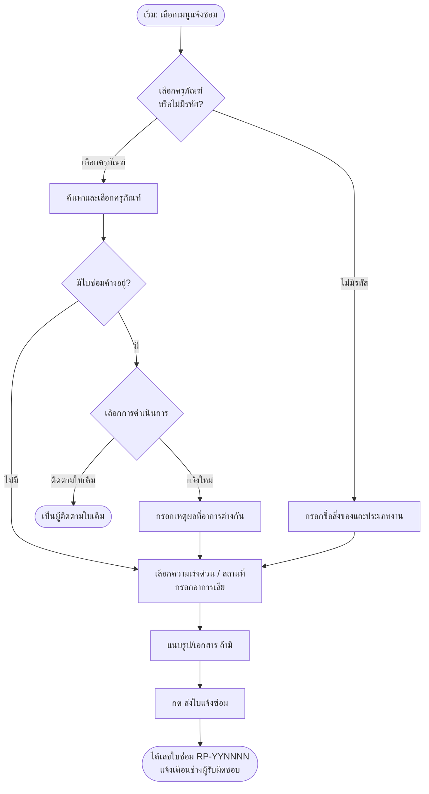
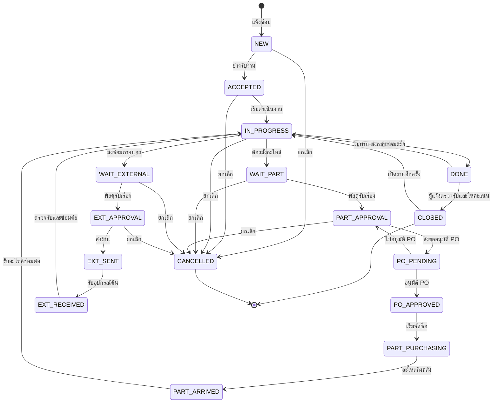
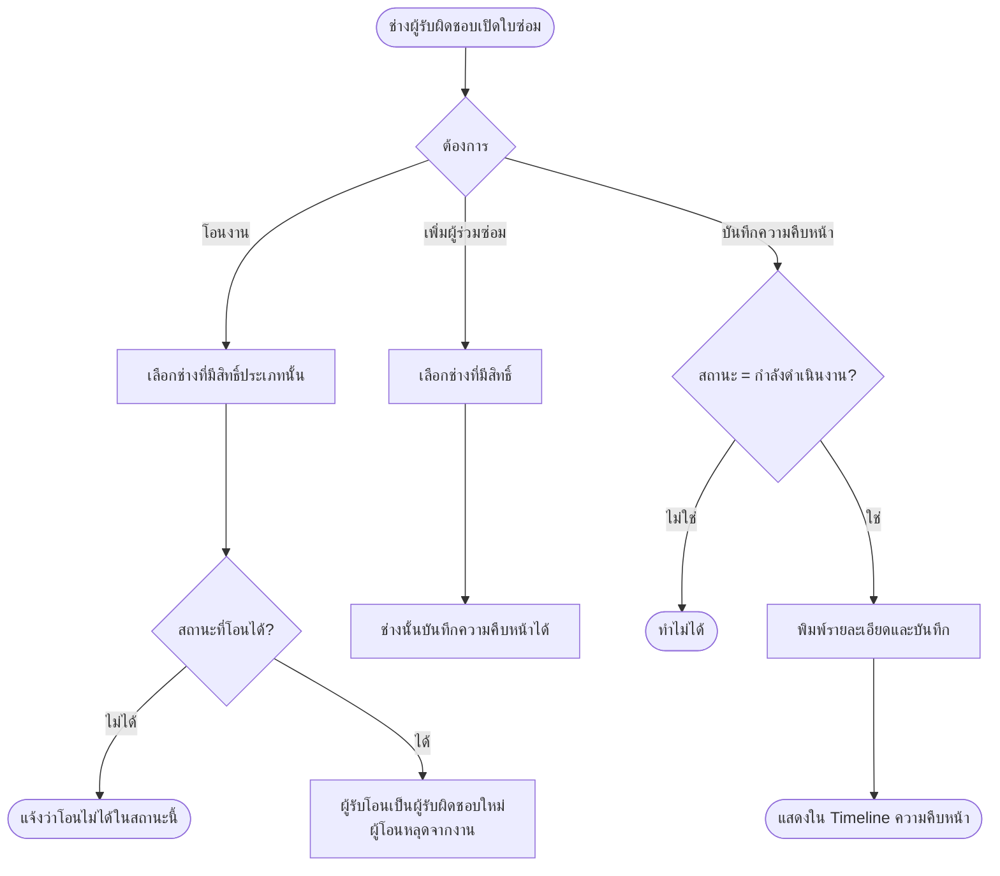
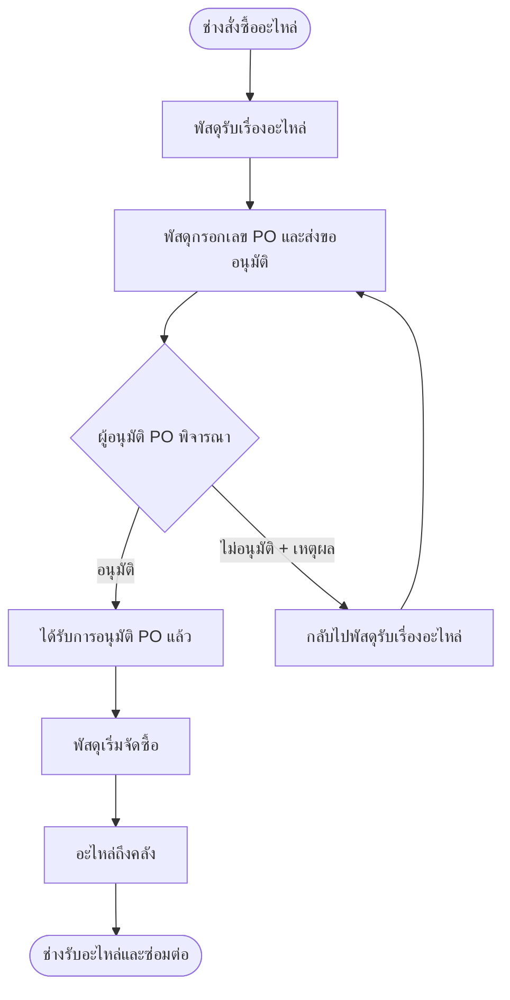

# คู่มือการใช้งานระบบแจ้งซ่อม (Repair System User Manual)

คู่มือนี้อธิบายการใช้งานเว็บระบบแจ้งซ่อม ทั้งแบบขั้นตอนและแบบแผนผัง (Flowchart)

---

## สารบัญ

1. [ภาพรวมระบบ](#1-ภาพรวมระบบ)
2. [บทบาทและสิทธิ์การใช้งาน](#2-บทบาทและสิทธิ์การใช้งาน)
3. [บัญชีทดสอบ](#3-บัญชีทดสอบ)
4. [การเข้าสู่ระบบและเมนูหลัก (Sidebar)](#4-การเข้าสู่ระบบและเมนูหลัก-sidebar)
5. [การแจ้งซ่อม](#5-การแจ้งซ่อม)
6. [หน้ารายการแจ้งซ่อม](#6-หน้ารายการแจ้งซ่อม)
7. [หน้ารายละเอียดใบซ่อม และการดำเนินการ](#7-หน้ารายละเอียดใบซ่อม-และการดำเนินการ)
8. [ขั้นตอนของแต่ละบทบาท](#8-ขั้นตอนของแต่ละบทบาท)
9. [การโอนงาน ผู้ร่วมซ่อม และความคืบหน้า](#9-การโอนงาน-ผู้ร่วมซ่อม-และความคืบหน้า)
10. [การอนุมัติ PO](#10-การอนุมัติ-po)
11. [ประวัติการซ่อม](#11-ประวัติการซ่อม)
12. [ประวัติการแก้ไข (Audit Log)](#12-ประวัติการแก้ไข-audit-log)
13. [ตั้งค่าระบบ](#13-ตั้งค่าระบบ)
14. [การแจ้งเตือนและ SLA](#14-การแจ้งเตือนและ-sla)
15. [คำถามที่พบบ่อย](#15-คำถามที่พบบ่อย)

---

## 1. ภาพรวมระบบ

ระบบแจ้งซ่อมใช้สำหรับแจ้งซ่อมและติดตามงานซ่อมของครุภัณฑ์ใน 3 ประเภท:

| ประเภท | ตัวอย่าง |
|---|---|
| คอมพิวเตอร์ (COMPUTER) | เครื่องคอมพิวเตอร์, จอภาพ, เครื่องพิมพ์ |
| เครื่องมือแพทย์ (MEDICAL) | Infusion pump, เครื่องวัดความดัน |
| ทั่วไป (GENERAL) | เครื่องปรับอากาศ, ระบบไฟฟ้า, เฟอร์นิเจอร์ |

ใบซ่อมแต่ละใบจะมีเลขที่ในรูปแบบ `RP-YYNNNN` (เช่น `RP-690001`) และผ่านหลายสถานะตั้งแต่แจ้งซ่อมจนถึงปิดงาน

---

## 2. บทบาทและสิทธิ์การใช้งาน

| บทบาท | ทำอะไรได้ |
|---|---|
| **ผู้แจ้งซ่อม (Requester)** | แจ้งซ่อม ติดตามใบซ่อมของตนเอง ตรวจรับงานและให้คะแนน |
| **ช่างซ่อม (Technician)** | รับงาน ดำเนินการซ่อม ขอซื้ออะไหล่ ส่งซ่อมภายนอก โอนงาน เพิ่มผู้ร่วมซ่อม บันทึกความคืบหน้า |
| **พัสดุ (Supply)** | รับเรื่องอะไหล่/ส่งซ่อมภายนอก ส่งขออนุมัติ PO บันทึกราคา วันที่ส่ง/รับคืน |
| **ผู้อนุมัติ PO (PO Approver)** | อนุมัติ PO หรือ ไม่อนุมัติ PO (ต้องระบุเหตุผล) |
| **ผู้ดูแลระบบ (Admin)** | เห็นทุกใบซ่อม ทุกสถานะ และทุกประเภท, ตั้งค่าระบบ, ดูประวัติการแก้ไข |

> หมายเหตุ: ผู้ใช้จะเห็นเฉพาะใบซ่อมของประเภทที่ตนมีสิทธิ์ (เช่น ช่างคอมพิวเตอร์จะไม่เห็นใบซ่อมเครื่องมือแพทย์) ยกเว้นพัสดุ ผู้อนุมัติ PO และผู้ดูแลระบบ

---

## 3. บัญชีทดสอบ

| Username | Password | บทบาท |
|---|---|---|
| `admin` | `admin123` | ผู้ดูแลระบบ (ทุกสิทธิ์) |
| `staff` | `staff123` | ผู้แจ้งซ่อม |
| `tech` | `tech123` | ช่างคอมพิวเตอร์ + ทั่วไป |
| `tech2` | `tech123` | ช่างคอมพิวเตอร์ + ทั่วไป + เครื่องมือแพทย์ |
| `supply` | `supply123` | พัสดุ |
| `poapprover` | `po123` | ผู้อนุมัติ PO |

---

## 4. การเข้าสู่ระบบและเมนูหลัก (Sidebar)

### 4.1 การเข้าสู่ระบบ

1. เปิดหน้าเว็บระบบแจ้งซ่อม
2. กรอก **Username** และ **Password** แล้วกดเข้าสู่ระบบ
3. หรือเข้าจากหน้า Hub (ระบบจะเข้าสู่ระบบให้อัตโนมัติ)

### 4.2 เมนู Sidebar

เมนูด้านซ้ายแสดงตามสิทธิ์ของผู้ใช้:

| ลำดับ | เมนู | คำอธิบาย |
|---|---|---|
| 1 | **รายการแจ้งซ่อม** | กลับไปหน้ารายการใบซ่อมทั้งหมด (อยู่บนสุด) |
| 2 | **Back to Hub** | กลับไปหน้า Hub |
| 3 | **กลุ่ม "แจ้งซ่อม"** | แจ้งซ่อมทั่วไป / คอมพิวเตอร์ / เครื่องมือแพทย์ (เฉพาะประเภทที่มีสิทธิ์แจ้ง) |
| 4 | **กลุ่ม "รายการการแจ้งซ่อม"** | ดูรายการใบซ่อมแยกตามประเภท (เฉพาะประเภทที่เห็นได้) |
| 5 | **ประวัติการซ่อม** | ประวัติและสถิติการซ่อม |
| 6 | **ประวัติการแก้ไข** | ประวัติการแก้ไขข้อมูล (เฉพาะผู้มีสิทธิ์) |
| 7 | **ตั้งค่าระบบ** | ตั้งค่าระบบ (เฉพาะผู้มีสิทธิ์) |

ไอคอนด้านหน้าเมนูประเภทจะเหมือนกันทั้งกลุ่มแจ้งซ่อมและรายการแจ้งซ่อม:
- 🏢 ทั่วไป
- 🖥️ คอมพิวเตอร์
- 🩺 เครื่องมือแพทย์

มุมขวาบนของหน้าจอมีปุ่ม **🔔 การแจ้งเตือน** แสดงจำนวนรายการที่ยังไม่ได้อ่าน

---

## 5. การแจ้งซ่อม

### 5.1 ขั้นตอน

1. เลือกเมนู **แจ้งซ่อม → แจ้งซ่อม[ประเภท]** (เช่น "แจ้งซ่อมคอมพิวเตอร์")
2. เลือกครุภัณฑ์
   - ค้นหาด้วยรหัสหรือชื่อ แล้วเลือกจากรายการ
   - หรือติ๊ก **"ไม่มีรหัสครุภัณฑ์"** แล้วกรอกชื่อสิ่งของเอง และเลือกประเภทงาน
3. ระบบจะตรวจว่าเครื่องนี้มีใบซ่อมค้างอยู่หรือไม่
   - ถ้ามี ให้เลือก **"ติดตามใบเดิม"** หรือ **"แจ้งใหม่ (อาการต่างกัน)"** แล้วกรอกเหตุผล
4. เลือกความเร่งด่วน (ต่ำ / ปกติ / สูง / วิกฤต)
5. กรอกสถานที่ตั้ง (ระบบเติมให้จากครุภัณฑ์ได้)
6. กรอก **อาการเสีย** (บังคับ)
7. แนบรูปอาการเสียหรือเอกสาร (ถ้ามี)
8. กด **ส่งใบแจ้งซ่อม**

ระบบจะสร้างใบซ่อมเลขที่ `RP-YYNNNN` และแจ้งเตือนช่างที่รับผิดชอบประเภทนั้นทันที

### 5.2 Flowchart: การแจ้งซ่อม

---

## 6. หน้ารายการแจ้งซ่อม

หน้ารายการแสดงใบซ่อมพร้อมแท็บ ตัวกรอง และ SLA

### 6.1 แท็บตามบทบาท

| บทบาท | แท็บที่เห็น |
|---|---|
| ผู้แจ้งซ่อม | แจ้งซ่อมของฉัน, รอช่างรับงาน, รอตรวจรับ, รายการที่เสร็จสิ้น, ยกเลิก/ปฏิเสธ, ทั้งหมด |
| ช่าง | งานที่ฉันรับผิดชอบ, รอช่างรับงาน, งานที่ยังไม่ปิด, รายการที่เสร็จสิ้น, ยกเลิก/ปฏิเสธ, ทั้งหมด |
| พัสดุ | งานพัสดุ, งานที่ฉันดำเนินการ, รอช่างรับงาน, งานที่ยังไม่ปิด, รายการที่เสร็จสิ้น, ยกเลิก/ปฏิเสธ, ทั้งหมด |
| ผู้อนุมัติ PO | **รออนุมัติ PO** (แท็บเดียว แสดงเฉพาะใบที่รอการอนุมัติ) |
| ผู้ดูแลระบบ | งานที่ยังไม่ปิด, รอรับงาน, รอตรวจรับ, งานพัสดุ, ยกเลิก/ปฏิเสธ, ทั้งหมด |

### 6.2 ตัวกรองและการค้นหา

- **ประเภทงาน**: เมื่อเข้าจากเมนูประเภทใด ตัวเลือกประเภทจะล็อก ให้เปลี่ยนประเภทจากเมนู Sidebar
- **ช่องค้นหา**: ค้นจากเลขใบซ่อม ชื่อ หรือรหัสครุภัณฑ์
- **ปุ่มสลับมุมมอง**:
  - *จัดลำดับ: ของฉันก่อน* (ค่าเริ่มต้น) แสดงใบที่ตนเป็นผู้แจ้งก่อน
  - *แสดงทั้งหมด (ไม่จัดลำดับของฉันก่อน)*

### 6.3 การเรียงลำดับ

กดที่หัวตาราง **เลขใบซ่อม / สถานะ / SLA / แจ้งเมื่อ** เพื่อเรียง:
- กดครั้งแรก เรียงจากมากไปน้อย (▼)
- กดอีกครั้ง เรียงจากน้อยไปมาก (▲)

### 6.4 ตัวบ่งชี้ SLA

| สี | ความหมาย |
|---|---|
| เขียว | ปกติ (ยังไม่ถึงกำหนด) |
| เหลือง | ใกล้ครบกำหนด (ถึง 80% ของเวลาที่กำหนด) |
| แดง | ครบกำหนดหรือเกินกำหนดแล้ว |

กดที่แถวใดก็ได้เพื่อเปิดหน้ารายละเอียดใบซ่อม

---

## 7. หน้ารายละเอียดใบซ่อม และการดำเนินการ

### 7.1 ส่วนประกอบของหน้า

| ส่วน | รายละเอียด |
|---|---|
| หัวใบซ่อม | เลขใบซ่อม ชื่อเรื่อง สถานะ ประเภท และความเร่งด่วน |
| ปุ่มการดำเนินการ (มุมขวาบน) | ปุ่มติดตาม/เลิกติดตาม, โอนงาน (เฉพาะช่างผู้รับผิดชอบ), และปุ่มสถานะถัดไปตามสิทธิ์ของคุณ |
| Timeline | ประวัติการเปลี่ยนสถานะและการแจ้งเตือน SLA เรียงจากล่าสุด |
| ความคืบหน้าการซ่อม | บันทึกความคืบหน้า (เฉพาะสถานะกำลังดำเนินงาน) |
| ผู้ร่วมซ่อม | รายชื่อผู้ร่วมซ่อม (ช่างผู้รับผิดชอบเพิ่ม/นำออกได้) |
| รายการอะไหล่ | อะไหล่ที่ขอซื้อ (พัสดุบันทึกราคาจริงได้) |
| ใบสั่งซื้อ (PO) | เลข PO สถานะ และผู้อนุมัติ |
| ส่งซ่อมภายนอก | ข้อมูลร้านและค่าซ่อม |
| ไฟล์แนบ | รูปและเอกสารของใบซ่อม |
| ข้อมูลครุภัณฑ์ | ข้อมูลครุภัณฑ์ ณ วันที่แจ้ง รวมผู้ซ่อมเสร็จ (Completed by) และผู้ปิดงาน |
| ผู้ติดตาม | ผู้ที่ติดตามใบนี้ |
| ซ่อมครั้งก่อนของเครื่องนี้ | ใบซ่อมก่อนหน้าของครุภัณฑ์เดียวกัน |

### 7.2 สถานะของใบซ่อม

| รหัสสถานะ | ชื่อที่แสดง |
|---|---|
| NEW | แจ้งซ่อม |
| ACCEPTED | รับงานซ่อม |
| IN_PROGRESS | กำลังดำเนินงาน |
| WAIT_PART | สั่งซื้ออะไหล่ |
| PART_APPROVAL | พัสดุรับเรื่องอะไหล่ |
| PO_PENDING | รออนุมัติ PO |
| PO_APPROVED | ได้รับการอนุมัติ PO แล้ว |
| PART_PURCHASING | กำลังจัดซื้ออะไหล่ |
| PART_ARRIVED | อะไหล่ถึงคลัง |
| WAIT_EXTERNAL | แจ้งส่งซ่อมภายนอก |
| EXT_APPROVAL | พัสดุรับเรื่องส่งซ่อม |
| EXT_SENT | ส่งร้านภายนอกแล้ว |
| EXT_RECEIVED | รับอุปกรณ์คืนแล้ว |
| DONE | ซ่อมแล้วเสร็จ (รอตรวจรับ) |
| CLOSED | ตรวจรับ+ปิดงาน |
| CANCELLED | ยกเลิก |

### 7.3 Flowchart: วงจรสถานะของใบซ่อม (ภาพรวม)

---

## 8. ขั้นตอนของแต่ละบทบาท

### 8.1 ช่างซ่อม (Technician)

#### ขั้นที่ 1: รับงาน
1. เปิดใบซ่อมสถานะ **แจ้งซ่อม** จากแท็บ "รอช่างรับงาน"
2. กดปุ่ม **รับงานซ่อม** (ระบบจะตั้งชื่อคุณเป็นผู้รับผิดชอบ)
3. ถ้าครุภัณฑ์มีรหัส ทะเบียนครุภัณฑ์จะเปลี่ยนเป็น "อยู่ระหว่างซ่อม"

#### ขั้นที่ 2: เริ่มดำเนินงาน
1. กด **เริ่มดำเนินงาน**
2. บันทึกความคืบหน้าได้ตามต้องการ (ดูหัวข้อที่ 9)

#### ขั้นที่ 3: ถ้าต้องใช้อะไหล่
1. กด **สั่งซื้ออะไหล่**
2. กรอกรายการอะไหล่: ชื่อ, รหัส, จำนวน, หน่วย, ราคาประมาณ
3. **แนบรูปอย่างน้อย 1 รูปต่อรายการอะไหล่ (บังคับ)**
4. กดยืนยัน ระบบจะแจ้งพัสดุ
5. เมื่ออะไหล่มาถึง พัสดุจะเปลี่ยนสถานะเป็น "อะไหล่ถึงคลัง" ให้กด **รับอะไหล่แล้ว ซ่อมต่อ**

#### ขั้นที่ 4: ถ้าต้องส่งซ่อมภายนอก
1. กด **ส่งเรื่องซ่อมภายนอก**
2. กรอกอาการ/เหตุผล (บังคับ) และร้านที่แนะนำ (ถ้ามี)
3. รอพัสดุส่งและรับคืน แล้วกด **ตรวจรับเครื่องแล้ว ซ่อมต่อ** (ในระบบแสดงเป็น "ตรวจรับอุปกรณ์และซ่อมต่อ")

#### ขั้นที่ 5: ซ่อมเสร็จ
1. กด **ซ่อมเสร็จ**
2. เลือกผลการซ่อม: ซ่อมได้ / ซ่อมไม่ได้ (รอจำหน่าย) / ตรวจแล้วไม่พบอาการ
3. กรอกสิ่งที่ซ่อม/ผลการซ่อม (บังคับ) และแนบรูปผลการซ่อม (ไม่บังคับ)
4. กดยืนยัน ระบบจะบันทึกชื่อคุณเป็น **ผู้ซ่อมเสร็จ** และส่งเรื่องให้ผู้แจ้งตรวจรับ

#### ถ้าผู้แจ้งส่งกลับซ่อม
- ใบจะกลับเป็น "กำลังดำเนินงาน" พร้อมเหตุผล ให้ซ่อมใหม่และกดซ่อมเสร็จอีกครั้ง

### 8.2 ผู้แจ้งซ่อม (Requester/Staff)

1. เปิดใบซ่อมที่สถานะ **รอตรวจรับ (DONE)**
2. ตรวจสอบงานซ่อม แล้วเลือก:
   - **ตรวจรับและปิดงาน**: ให้คะแนนความพึงพอใจ 1–5 ดาว (บังคับ) และใส่ความเห็นได้
   - **ไม่ผ่าน ส่งกลับซ่อม**: กรอกเหตุผล (บังคับ) ใบจะกลับไปที่ช่าง
3. **ยกเลิกใบซ่อม**: ทำได้ในสถานะที่ยังไม่เริ่มซ่อมหรือระหว่างดำเนินงาน ต้องกรอกเหตุผล (บังคับ)
4. ถ้างานปิดไปแล้วและยังไม่หาย สามารถ **เปิดงานอีกครั้ง** ได้

### 8.3 พัสดุ (Supply)

#### อะไหล่
1. รับเรื่องอะไหล่: เปลี่ยนเป็น **พัสดุรับเรื่องอะไหล่** (เมื่อช่างสั่งซื้อ)
2. **ส่งขออนุมัติ PO**: กรอกเลขที่ PO (บังคับ) และวันที่ PO (ค่าเริ่มต้นคือวันนี้) แนบเอกสาร PO ได้
3. รอผู้อนุมัติ PO
   - ถ้าอนุมัติ: เปลี่ยนเป็น "ได้รับการอนุมัติ PO แล้ว" ให้กด **เริ่มจัดซื้ออะไหล่**
   - ถ้าไม่อนุมัติ: ใบจะกลับมาที่ "พัสดุรับเรื่องอะไหล่" พร้อมเหตุผล ให้แก้ไขแล้วส่งขออนุมัติ PO ใหม่
4. เมื่ออะไหล่มาถึง กด **อะไหล่ถึงคลังแล้ว**
5. บันทึก **ราคาจริงของอะไหล่** ได้ในรายการอะไหล่ (การแก้ไขราคาที่บันทึกแล้วต้องระบุเหตุผล)

#### ส่งซ่อมภายนอก
1. กด **รับเรื่องส่งซ่อม** (ขั้นอนุมัติส่งซ่อม)
2. กด **ส่งร้านภายนอกแล้ว**: กรอกชื่อร้าน และวันที่ส่ง (บังคับ)
3. กด **รับเครื่องคืนแล้ว**: กรอก **วันที่รับอุปกรณ์คืน (บังคับ)** และ **ค่าซ่อม (บาท) (บังคับ)** รวมถึงเลขใบแจ้งหนี้/ใบเสร็จ (ถ้ามี)

> วันที่ทุกช่องจะตั้งค่าเริ่มต้นเป็นวันปัจจุบัน และไม่สามารถเลือกวันในอนาคตได้

### 8.4 ผู้อนุมัติ PO (PO Approver)

1. เปิดแท็บ **รออนุมัติ PO** ซึ่งจะแสดงเฉพาะใบที่รอการอนุมัติ
2. ตรวจสอบรายการอะไหล่และเอกสาร PO
3. เลือกการดำเนินการ:
   - **อนุมัติ PO**: ใบจะไปต่อที่ "กำลังจัดซื้ออะไหล่"
   - **ไม่อนุมัติ PO**: กรอกเหตุผล (บังคับ) ใบจะกลับไปให้พัสดุตรวจสอบและส่งขออนุมัติใหม่

---

## 9. การโอนงาน ผู้ร่วมซ่อม และความคืบหน้า

### 9.1 โอนงานให้ช่างคนอื่น
- ผู้ทำได้: **ช่างผู้รับผิดชอบปัจจุบัน** หรือผู้ดูแลระบบ
- ทำได้ในสถานะ: รับงานซ่อม, กำลังดำเนินงาน, สั่งซื้ออะไหล่, แจ้งส่งซ่อมภายนอก, อะไหล่ถึงคลัง, รับเครื่องคืนแล้ว
- ขั้นตอน: กด **โอนงานให้ช่างคนอื่น** → เลือกช่างที่มีสิทธิ์ประเภทนั้น → ใส่เหตุผล (ไม่บังคับ) → ยืนยัน
- ผลลัพธ์: ชื่อผู้รับผิดชอบเปลี่ยนทันที และแจ้งเตือนผู้แจ้ง ผู้รับโอน และผู้ติดตาม

### 9.2 ผู้ร่วมซ่อม (Co-technician)
- เพิ่ม/นำออก: ทำได้โดยช่างผู้รับผิดชอบหรือผู้ดูแลระบบ
- ผู้ร่วมซ่อม **บันทึกความคืบหน้าได้** แต่ **ไม่สามารถเปลี่ยนสถานะได้**

### 9.3 บันทึกความคืบหน้า
- ทำได้เฉพาะตอนสถานะ **กำลังดำเนินงาน** โดยผู้รับผิดชอบ ผู้ร่วมซ่อม หรือผู้ดูแลระบบ
- พิมพ์รายละเอียดแล้วกด **บันทึกความคืบหน้า** บันทึกหลายครั้งได้
- ระบบแสดงเป็น Timeline พร้อมชื่อผู้บันทึกและเวลา

### 9.4 Flowchart: การโอนงานและผู้ร่วมซ่อม

---

## 10. การอนุมัติ PO

---

## 11. ประวัติการซ่อม

เมนู **ประวัติการซ่อม** มี 2 ส่วน:

### 11.1 ตารางใบซ่อมทั้งหมด
- ดูใบซ่อมทั้งหมดที่คุณมีสิทธิ์เห็น ทั้งที่มีและไม่มีรหัสครุภัณฑ์
- กรองตาม **ประเภท** (ทุกประเภท / คอมพิวเตอร์ / เครื่องมือแพทย์ / ทั่วไป) และ **มี/ไม่มีรหัสครุภัณฑ์**
- ค้นหาจากเลขใบ ชื่อ อาการ หรือแผนก

### 11.2 สถิติการซ่อมรายครุภัณฑ์
- ตารางแสดงจำนวนครั้งที่ซ่อมของแต่ละเครื่อง **นับทุกใบ รวมใบที่ยกเลิก**
- คอลัมน์: ซ่อมทั้งหมด, ใน 12 เดือน, ยกเลิก, ค่าซ่อมสะสม, ซ่อมล่าสุด
- กดแถวใดก็ได้เพื่อดูสรุปของเครื่องนั้น (ประวัติ, MTBF, ค่าซ่อมรวม, และคำแนะนำให้จำหน่ายถ้าเข้าเกณฑ์)

---

## 12. ประวัติการแก้ไข (Audit Log)

- ใช้ได้เฉพาะผู้มีสิทธิ์ **ดูประวัติการแก้ไข**
- แสดงการเปลี่ยนแปลงข้อมูลสำคัญ เช่น ค่าตั้งระบบ กฎ SLA ราคาอะไหล่ และสถานะครุภัณฑ์
- กรองตามตาราง และช่วงวันที่ (ค่าเริ่มต้นเป็นวันปัจจุบัน ล้างช่องวันที่เพื่อดูย้อนหลัง)
- ประวัติไม่สามารถแก้ไขหรือลบได้

---

## 13. ตั้งค่าระบบ

เฉพาะผู้มีสิทธิ์ **ตั้งค่าระบบแจ้งซ่อม** สามารถ:

- แก้ค่าตั้งระบบ เช่น วงเงินที่ต้องมีใบเสนอราคา ขนาดไฟล์แนบสูงสุด จำนวนไฟล์ต่อใบ และรอบการตรวจงานค้าง
- แก้กฎ SLA (เวลาเตือนและการเปิดใช้งาน)
- **ทุกการแก้ไขต้องระบุเหตุผล (บังคับ)** และจะถูกบันทึกในประวัติการแก้ไข

---

## 14. การแจ้งเตือนและ SLA

### 14.1 การแจ้งเตือน
- ระบบแจ้งเตือนเมื่อมีใบซ่อมใหม่ มีการเปลี่ยนสถานะ มีการโอนงาน หรือมีผู้ติดตามเพิ่ม
- ดูได้จากปุ่ม 🔔 มุมขวาบน กดรายการเพื่อไปยังใบซ่อม
- ระบบจะตรวจงานค้างตามรอบที่ตั้งไว้ และส่งแจ้งเตือนผู้เกี่ยวข้องเมื่อเกินกำหนด

### 14.2 ระยะเวลา SLA ตามสถานะ (ค่าเริ่มต้น)

| สถานะ | เตือนเมื่อค้างเกิน |
|---|---|
| แจ้งซ่อม (NEW) | 24 ชั่วโมง (วิกฤต: 2 ชั่วโมง) |
| รับงานซ่อม (ACCEPTED) | 24 ชั่วโมง |
| กำลังดำเนินงาน (IN_PROGRESS) | 72 ชั่วโมง |
| สั่งซื้ออะไหล่ / แจ้งส่งซ่อมภายนอก | 24 ชั่วโมง |
| พัสดุรับเรื่องอะไหล่ / พัสดุรับเรื่องส่งซ่อม | 72 ชั่วโมง |
| รออนุมัติ PO | 72 ชั่วโมง |
| ได้รับการอนุมัติ PO แล้ว | 24 ชั่วโมง |
| ส่งร้านภายนอกแล้ว | 336 ชั่วโมง (14 วัน) |
| รอตรวจรับ (DONE) | 72 ชั่วโมง |

---

## 15. คำถามที่พบบ่อย

**Q: ทำไมไม่เห็นใบซ่อมบางใบ?**
A: ระบบแสดงเฉพาะประเภทที่คุณมีสิทธิ์ ติดต่อผู้ดูแลระบบหากต้องการสิทธิ์เพิ่ม

**Q: แจ้งซ่อมแล้วขึ้นว่ามีใบซ่อมค้างอยู่?**
A: เครื่องนี้มีใบที่ยังไม่ปิด ให้กด "ติดตามใบเดิม" หรือหากอาการต่างกันให้กด "แจ้งใหม่" และกรอกเหตุผล

**Q: ทำไมบันทึกความคืบหน้าไม่ได้?**
A: ต้องอยู่ในสถานะกำลังดำเนินงาน และคุณต้องเป็นช่างผู้รับผิดชอบหรือผู้ร่วมซ่อม

**Q: ทำไมส่งขั้นตอนถัดไปไม่ได้?**
A: ตรวจว่าบันทึกข้อมูลบังคับครบ (เช่น หมายเหตุ รูปอะไหล่ เลข PO ค่าซ่อม วันที่) และตรวจว่าคุณมีบทบาทที่ทำขั้นนั้นได้

**Q: วันที่ในฟอร์มเป็นอะไร?**
A: ค่าเริ่มต้นเป็นวันปัจจุบัน และไม่สามารถเลือกวันในอนาคตได้
